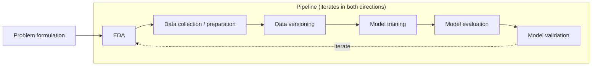
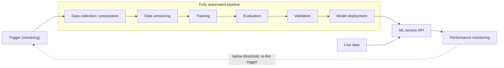
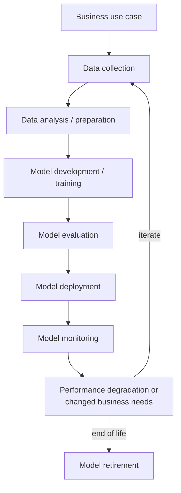
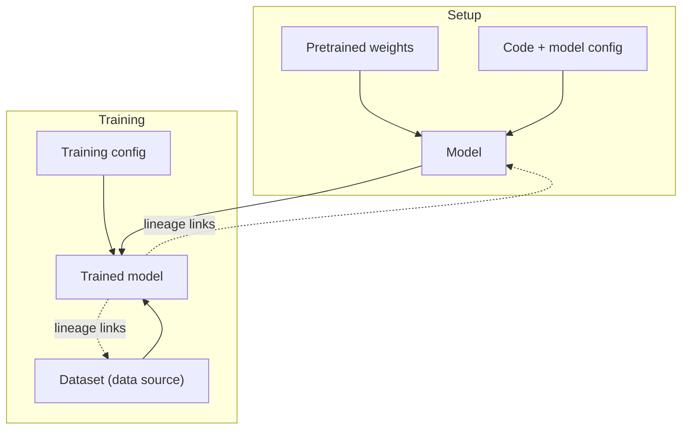

# Machine Learning Platform Engineering — Chapters 1–3 Summary

> Source book: *Machine Learning Platform Engineering: Build an internal developer platform for ML and AI systems*  
> Scope: **Part 1 — Laying the MLOps foundation (Ch. 1–3)**  
> Code: [https://github.com/practical-mlops](https://github.com/practical-mlops)  

---

# Chapter 1. Getting Started with MLOps and ML Engineering

## 1.1 The ML Lifecycle

Where software projects prioritize stability, ML projects are inherently **iterative**. The authors' experience: "We have never seen an ML project that ended with its first deployment."

### 1.1.1 The Experimentation Phase

The arrows are drawn in one direction, but the real flow is **non-linear with loops**. If the evaluation metrics are bad, you go back to the model architecture, or further back to re-examine data quality. That is why the steps are tied together as an **orchestrated pipeline** from this phase onward: automation is built in from the start, which reduces hard-to-trace mistakes.

**Key points per step**

- **Problem formulation**: The first question is "Do we need ML at all?" Don't swing the ML hammer at something a simple heuristic can solve. Conversely, if the pattern is high-dimensional and non-linear, ML is warranted. The decision is made jointly by business/product and technical staff. Example: an OCR model extracts the ID number from an identity card → detect fraud in a timely way while keeping false positives to a minimum.
- **Data collection & preparation**: Secure data sources → labeling (bounding boxes, hand-typed ID numbers) → split into train/validation/test. If real data is hard to obtain, consider generating **synthetic data**. Labeling is labor-intensive, and for fraud detection a domain expert has to comb through the dataset.
- **Data versioning**: An ML project consists of *code + data*. Just as behavior changes when code changes, **behavior also changes when data changes.** This is the key to reproducibility. Code is easy with Git, but data comes in many forms (images/CSV/DataFrames) and the community has no tool as universal as Git yet.
- **Model training**: Once the dataset and training strategy are defined, it can be automated. Automation → multiple experiments run concurrently, and parameters and artifacts are tracked, giving reproducibility. Contrary to what newcomers assume, **training does not take up most of the time.** (This book's focus is not model training either.)
- **Model evaluation**: Measure performance on data not included in the training set: precision / recall / AUC, etc.
- **Model validation**: Once evaluation passes, check "does it behave as expected?" This is usually done by business stakeholders, **not** the team that built the model.

### 1.1.2 The Development / Staging / Production Phase

The diagram looks similar to the experimentation phase, but two things differ.

1. The pipeline is **fully automated** (triggered by CI or programmatic calls).
2. **Model deployment** is attached at the end of the pipeline, and the result is usually an ML service in the form of a REST API.

- **Model deployment**: The simplest path is REST API → containerize (Docker) → deploy to the cloud (AWS/GCP). Some organizations hand off to IT/DevOps/MLOps at this point, but the authors believe it pays off to **keep the data scientist involved**. Deployment is not the end → you need load testing, autoscaling (to absorb spikes), **deployment version management**, and a **rollback strategy**.
- **Model monitoring**: "A model does not survive first contact." Once it meets live data, it doesn't perform as well as it did in evaluation. Two kinds of signals must both be watched:
  - **System/operational metrics**: RPS, aggregated HTTP status codes, etc.
  - **ML-specific metrics**: data drift, model drift
  - In addition, use **business metrics** (churn rate, retention) to measure the value the model creates.
- **Model retraining**: "When do we retrain?" → It depends. But retraining should be **automated as much as possible**. Automating training alone is not enough; **deployment must be automated too** so the new model ships automatically. Triggers: a fixed schedule (monthly) or a threshold (e.g., loan approvals drop sharply).

## Chapter 1 Summary

- The ML lifecycle is a framework for getting from idea to production. It is iterative, but understanding each stage lets you navigate the complexity.
- A reliable ML system = software engineering + MLOps + data science. Rather than mastering everything at once, focus on **how the pieces mesh**.
- Platform tools: Kubeflow Pipelines for automation, MLflow for model management, Feast for feature management.
- Traditional MLOps principles extend naturally to LLMOps (adding document processing, retrieval, and specialized monitoring).
- In any ML project, the **first step is identifying the problem to solve**, followed by data collection and preparation. Data versioning provides reproducibility, and pipelines provide training automation.

---

# Chapter 2. What Is MLOps?

The biggest reason MLOps is hard: **the gap between creating business value, the requirements, and the infrastructure needed.**

Once the problem is defined and the ML architecture chosen, **the really hard questions** arise:

- How do we train the model?
- How do we get data to the model?
- How does the model interact with other services?
- **Where** do we run the model?
- How do we make sure it stays accurate over time?

## 2.1 The Iterative MLOps Lifecycle

The core mental model is a **closed loop.** Models, data, and hyperparameters are **ephemeral**, parts of a loop that evolves as a whole. Seen this way, you design "the process for when the model changes."

> **The model (weights + network) and the code (architecture + supporting code) are separate entities.** That is why lineage and tracking are the heart of a sustainable workflow.

### Essential Questions by Stakeholder

A statement like "predict customer churn" is **not enough** to decide on modeling and evaluation criteria.

**Business / Product**

- Why does this problem/task need ML?
- What are the business goals and success metrics?
- What is the value created relative to the development effort?
- What is the project timeline?
- Where on the roadmap is the value greatest?
- **What is the business impact of a wrong prediction? What error margin is acceptable?**

**Technical team (ML engineers + data scientists)**

- Is it solvable with ML? Is ML the best approach? Is there prior research/literature?
- Where and how is the data stored? What data pipelines are needed?
- What are the evaluation methods and metrics?
- What compute is needed for training and serving?
- What deployment strategy enables future upgrades and maintenance?
- **Which metrics should trigger retraining?**

**Legal / Compliance**

- What are the ethical and privacy concerns?
- How is sensitive information in the dataset handled?
- What data governance requirements must be met?

Answering these questions **together** gives you: clearer scope and deliverables, business–technical alignment, early risk discovery, and better communication between data scientists and ML engineers.

### 2.1.1 Data Collection

Every later stage depends on this one and inherits its biases.

**Common requirements**

- Relevance to the problem domain
- Dataset size relative to problem complexity
- Dataset quality
- Avoiding harmful bias and unintended sample leakage
- A data/feature distribution that represents the deployment environment
- Diversity in the collection process that defines the problem domain well

Why lineage matters: it is usually overlooked, and is like technical debt, trading early speed for future complexity and maintainability.

1. It establishes the provenance of the data: metadata on when, where, how, and why it was collected is essential for understanding its limits and choosing appropriate features.
2. Versioning and reconstructing datasets becomes a linear task, and bad data can be rolled back. The first version is rarely the best. With lineage, the difference is "re-running one query" versus "rewriting a complex extraction script."

### 2.1.2 Exploratory Data Analysis (EDA)

This is the **first line of defense** against under-defined problems, especially dataset problems, and is critical for refining effort estimates for development and maintenance.

**Target questions**

- What does my data look like? What is the schema? Can the schema change? How do I prevent invalid values? Does it need cleaning?
- What are the distributions? Are all targets equally represented? Is extra class balancing needed?
- Are there **robust features** for the target task? Are the features expensive to compute?
- Does the input data **fluctuate periodically**? Is it correlated with external factors that aren't modeled?
- What are the outliers? How will outlier values be handled in production?

### 2.1.3 Modeling and Training

Factors in choosing a model/algorithm: theoretical performance, input data type, and problem type (classification/detection/regression, etc.).

The MLOps toolbox at this stage:

- Model & data versioning
- Experiment tracking
- Model training pipelines
- Hyperparameter search

**Lineage and traceability**, plus **eliminating error-prone manual steps**:

- **Model/data versioning**: Every model is inherently tied to a specific dataset version, and can be reproduced from scratch for debugging and compliance.
- **Experiment tracking**: The same rigor even at the prototyping stage: results + the data used + the exact configuration and checkpoints are logged together. **You never lose experiments or results.** A unified interface also improves collaboration and reporting.
- **Hyperparameter optimization**: Once developers supply the search space and loss function, it can be automated. → So keep the **codebase modular**, and treat a trained model as an "**artifact** produced by applying configuration + data to the codebase."

**Modular retraining pipeline**

Keeping the model, code, config files, and data as **separate, individually versioned components connected by lineage links** makes experimentation, debugging, and iterative development all more flexible and faster.

### 2.1.4 Model Evaluation

Metric choice depends on the domain and is strongly affected by data factors such as class imbalance and drift.

- Classification/detection: precision, recall, F1
- Regression: MAE, MSE, etc.
- Even within classification, needs differ by domain: **healthcare** is strict about false-positive rate/precision (to minimize harm), while **finance** emphasizes recall to reduce institutional losses from missed events.

→ It is essential to understand the implications and trade-offs of a metric choice and to **align it with the requirements and business goals set at the start**.

### 2.1.5 Deployment

Common approaches:

1. **An API endpoint that fits a microservice architecture**: the model handles requests behind an API layer.
2. **Deployment to specific hardware/edge devices**: less common than APIs, but important in areas like automotive, security equipment, and robotics, where the device performs critical tasks such as perception.

Both approaches focus on performance and latency → they go through an **optimization step** specific to the deployment environment. **Performance testing must be done on the final (optimized) version** so measurements match real results. Example: a model may seem to meet requirements during GPU training, but on an embedded device performance can differ greatly because of how the accelerator behaves or how the device toolchain handles quantization.

Deployment is often split into **staging / production**. The staging model runs in evaluation mode, compares its effect to the production model, and is automatically promoted to production when evaluation finishes (a two-stage process). **Robust model versioning and lineage** log every transition, making a rollback as simple as swapping the model in production.

### 2.1.6 Monitoring

Wrong predictions can **actively obstruct or damage** the business. Performance changes over time due to input data shifts, concept drift, and hardware/software failures.

- **Data monitoring**: Evaluate the statistical properties of input data to detect anomalies. **Data drift** (change in the input data) is a problem because the model's training data and production data diverge, producing unexpected wrong predictions.
- **Performance monitoring**: Track the production model's accuracy and prediction metrics to confirm effectiveness stays high. Viewed as a time series, you can identify performance problems and take corrective action.
- **Error monitoring**: Identifying and understanding wrong predictions is a powerful way to improve performance over time. Analyzing errors helps you understand the model's behavior on edge cases and reduce or eliminate their impact.

### 2.1.7 Maintenance, Updates, and Review

The last component, which **closes** the loop. Using the monitoring output you can:

- Fix bugs and defects in the production model
- Collect data to train on specific edge cases and improve performance
- Mitigate data drift by notifying the data collection component and retraining a new model

An important point of view: this component is **distributed across the entire loop.** The deployment component has a maintenance aspect (replacing the production model with a new version), and data collection has an update aspect (handling concept/data drift found by monitoring).

## 2.2 Why Robust MLOps Matters

- Even a **single block** of the loop (e.g., data collection) is a daunting subject, and implementing it successfully at scale takes experts. Each block adds a layer (or more) of complexity. Getting it right on the first try is very hard; you keep tweaking components and infrastructure until a good solution converges.
- **Data** is a core component. Managing it at scale without sacrificing visibility, guaranteeing privacy, and implementing robust data security are expensive, and violations can lead to lawsuits or major financial losses. Curating for fairness, diversity, and absence of bias adds further complexity.
- A modern MLOps system is an **extremely complex beast.** Millions of decisions (integration between components, data exchange, overall architecture) can strongly affect model output and the whole project. A system with data management, extraction, annotation, versioning, EDA, training, deployment, and monitoring has so many moving parts that **it is harder to see the big picture and diagnose systemic flaws.**
- **Barriers to communication**: Data scientists speak in precision, recall, and F1, while ML engineers speak in model registries, serving latency, time to deploy, and scaling request handling. For the loop to succeed, all contributors and external stakeholders need to use **the same language**.
- **Optimization and scaling** are low priority early on, but can break a model's usability. The world's best model has zero value if it doesn't work in production or collapses under high load. Performance characteristics after optimization can differ greatly from the unoptimized version, and scaling to thousands or millions of requests is a completely different challenge from evaluation or toy workloads.
- **Messy real-world data**: Without preparation, edge cases and inappropriate data cause failures, and in the worst case **distort outputs without any visible error.** Robust monitoring and strong data validation can prevent this, but edge cases can still slip through and produce unexplainable outputs.
- **Governance/compliance** requires explainable and interpretable ML. Applying responsible AI practices while addressing bias and ensuring compliance is hard.
- **Tool fragmentation**: For model registries alone, more than ten products claim to "solve AI's problems." Comprehensive solutions are rare, and some focus on core areas like EDA and model deployment while missing important aspects like **data management and lineage** entirely. The current industry philosophy is to combine specialized tools with a few comprehensive solutions to fit the team's needs.

→ For these reasons, small teams choose to skip robust MLOps and build fast. That works in the short term or for a single model, but it builds up **massive technical debt over the long term** and makes the model unmaintainable. Overcoming this takes investment in technical skills, cross-functional collaboration, and a culture that favors continuous learning. MLOps is hard, but a robust strategy pays long-term dividends in speed, maintainability, and, above all, **business value**.

## 2.3 The Role of MLOps in Mature Organizations

- **Accelerating innovation and experimentation**: With infrastructure abstracted, easy model versioning and comparison (backed by strong lineage of code/config/checkpoints/data), and A/B testing in place, data scientists can validate hypotheses, tune hyperparameters, and respond to changing business needs faster.
- **Cost optimization**: Without a central workflow, each team builds its own development and infrastructure silo, leading to suboptimal resource use and fragmented best practices. A centrally cohesive strategy lets teams leverage each other's strengths, share pipelines and components, manage resource allocation, and use autoscaling and cost monitoring.
- **Cross-team collaboration**: Teams solve common challenges and business problems across domains. Even **within** a team, visibility into each other's activities and standard tooling improve collaboration. Clear communication and collaboration channels are established.
- **Improved efficiency**: MLOps + CI/CD automate repetitive tasks such as data mining, preprocessing, feature engineering, training, and deployment → fewer human errors, and output and behavior become deterministic. Data scientists can focus on high-value work like modeling and innovation.
- **Better repeatability and traceability**: The evolution of a model becomes visible, and when problems arise there are means for monitoring, debugging, and rollback. Processes for handling drift, bias, and regressions through robust monitoring are also established. With strong lineage, you can easily trace which configuration and dataset produced a model, enabling **offline debugging**.
- **Robust scaling**: Common workflows and optimized resource allocation standardize the challenges of scaling and large-scale data handling.

A good MLOps strategy **lowers the barrier to good practices.** For example, if model logging is already configured and integrated in the training codebase, data scientists use **versioning and logging by default** instead of managing training runs by hand and writing ad hoc reports.

## 2.4 DevOps vs. MLOps

**What is unique to MLOps**

- MLOps is mainly concerned with the challenges of **training, deploying, monitoring, and optimizing ML models**. DevOps focuses on the software and infrastructure lifecycle.
- **Data is the decisive differentiator.** MLOps treats data as an essential component of models and processes, and devotes a large part of its effort to managing the data lifecycle. DevOps does not apply that rigor to data management.
- **Even without code changes, models keep changing and evolving.** → **Continuous Training** is added, and model management and versioning need special consideration.
- MLOps inherently deals with **model interpretability and bias**, including monitoring techniques that ensure compliance with agreed-upon standards.
- **Performance monitoring is decisive**, because degradation can occur when input data characteristics change. As Google points out, ML models can **degrade in more ways** than traditional software.
- MLOps is inherently **experimental and iterative.** So it is important to **track the experiments themselves**, not just the builds.

## 2.5 MLOps Maturity Levels

According to Google, the **level of automation** of the stages discussed so far is a good indicator of a company's MLOps maturity. It translates directly into how fast new models are developed or how fast the company adapts to change.

| Level | Name | Characteristics |
|-------|------|-----------------|
| **0** | Basic | Build, training, and deployment via manual scripts. **No monitoring.** Releases are far apart and infrequent. Most companies just starting the journey are here. |
| **1** | Intermediate | Experiment velocity plus continuous retraining in production. Level 0 deployed **only the model**, while Level 1 deploys **the entire retraining pipeline**, giving continuous delivery of a prediction service that automatically improves as new data arrives. With **modular pipeline components** shared freely across teams, the same pipeline is used in development and production = **experimental-operational symmetry**. |
| **2** | Advanced | **Automates the build and deployment of the pipelines themselves**, and pipeline components become central to the ML loop. Nearly everything except data analysis and model analysis is automated. Pipelines and components are **owned by the whole team/organization**, not just ML engineers, and data scientists can contribute new components based on their observations. |

**Prerequisites that enable Level 1**

- Robust data and model validation mechanisms
- A feature store (if needed)
- Pipeline monitoring, lineage, and related metadata
- Automatically triggered ML pipelines that run on custom triggers

These levels are a rough guide, and difficulty does not increase linearly from one level to the next. Still, **knowing where you are** helps you plan to advance steadily while building your internal MLOps culture. The tools covered in the book can **scale to every maturity level.**

## Chapter 2 Summary

- ML exists **to solve business problems.** It is important to understand the requirements deeply before starting.
- MLOps is an **iterative process** of developing, monitoring, and improving ML models.
- **The model is an artifact of the ML loop**, and the loop aims to improve performance over time.
- Why MLOps is hard: data management, complex tooling, organizational structure, scaling challenges, and real-world unpredictability.
- Skipping established ML practices looks faster in the short term, but duplication and technical debt quickly erase the gains.
- DevOps and MLOps are similar but differ in areas like **data and model management**, and MLOps has challenges of its own.
- Robust MLOps is a highly experimental, iterative process, leaving room to find **what fits our organization** through organizational learning and rapid prototyping.

---

# Chapter 3. Building Applications on Kubernetes

Chapter 3 provides core concepts, but since they are generally well known, we decided to only go over a simple list of the key ideas.

Chapter 3 covers **Kubernetes and containerization**, providing the core concepts ML engineers need to understand and manage infrastructure. The chapter can be summarized as follows.

- **Containerization**: Run applications and their dependencies in isolated environments. Use Docker to provide a consistent environment.
- **Kubernetes**: An open-source platform for deploying, scaling, and managing containerized applications. You need to understand core concepts such as Pod, Deployment, and Service.
- **CI/CD**: Continuous integration and continuous deployment. Build pipelines that automatically build, test, and deploy code changes. This also applies to ML model training and deployment.
- **Helm**: A tool for packaging and deploying Kubernetes applications. Helm Charts make it easy to deploy and manage complex applications.
