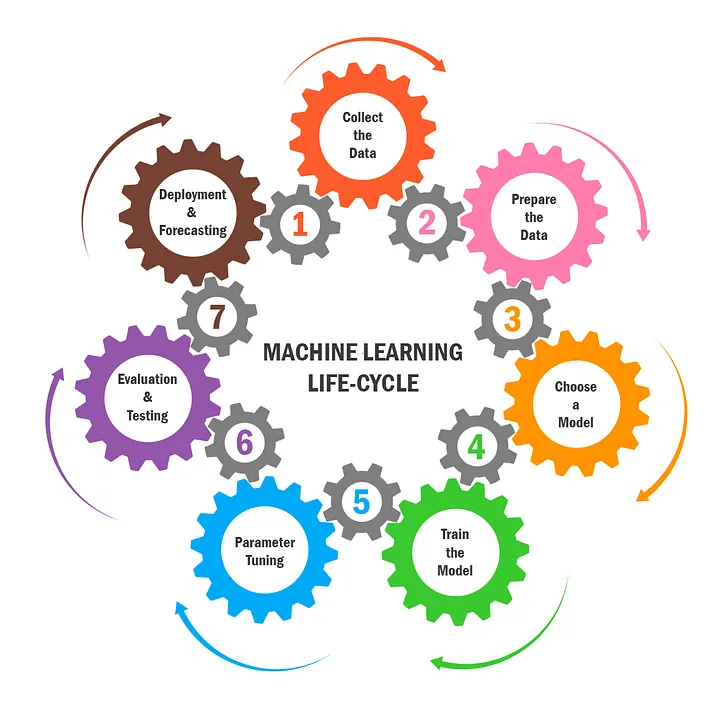
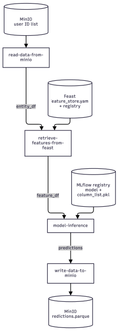

# Part 2 — Designing Reliable ML Systems and Orchestrating ML Pipelines

> Source book: *Machine Learning Platform Engineering: Build an internal developer platform for ML and AI systems*  
> Scope: **Part 2 - Designing Reliable ML Systems and Orchestrating ML Pipelines**  
> Code: [chapter-4](https://github.com/practical-mlops/chapter-4), [chapter-5](https://github.com/practical-mlops/chapter-5)  
>

**Running example:** a binary classifier that predicts income band (`<=50K` vs `>50K`) from about 30k rows of purely categorical data (workclass, education, marital status, occupation, relationship, race, sex, native country).

**The arc of the two chapters:** Ch. 4 makes work *traceable* (MLflow for experiments and models, Feast for features). Ch. 5 makes it *automatic* (Kubeflow Pipelines wires those pieces into a batch inference pipeline).

---

## Chapter 4. Designing Reliable ML Systems

**Goal:** turn ad hoc notebook experimentation into something reproducible, comparable, and deployable. The chapter covers three platform components: the experiment tracker, the model registry, and the feature store.

### 4.1 MLflow experiment tracking

**Why track:** reproducibility (share and re-run), model selection (compare architectures), and performance tracking (compare retrained models against earlier ones). The authors argue that Git commits or parameter files get awkward fast. A central tracking server answers "which model is in production, which parameters gave the best result, and can we reproduce last quarter's result?"

**Core concepts**
- **Experiment** is a project-level grouping (here, `income-classifier`).
- **Run** is one execution, identified by a run ID, and holds params, metrics, artifacts, and datasets.
- **Artifacts** are anything saved to disk: models, plots, datasets.

**Workflow in the chapter**
1. Start a local tracking server (`mlflow ui`, port 5000), then set the tracking URI and experiment name.
2. Log the EDA plots (category vs. target distributions) as artifacts of a separate "eda" run, so EDA runs stay distinct from model-building runs.
3. Preprocess with one-hot encoding and **save the column list**. It is needed later at inference so the feature columns line up.
4. Split 80/20 and **store train, test, and reference datasets in object storage (MinIO)**. Log their paths with `mlflow.data.from_pandas` and `log_input`, tagged with the contexts training, testing, and reference. MLflow keeps only the metadata (columns, types, row count), while the data itself stays in the bucket.
5. Train a decision tree, a random forest, and an XGBoost model. Log ROC AUC and accuracy for train and test, plus the model and its parameters.
6. For XGBoost, use `autolog()`. It captures parameters, the model, and feature-importance plots with one line. Custom metrics still have to be logged manually, and autolog records the training data as an array rather than a DataFrame.

#### 4.1.3 Model registry

- Choose the best run either in the UI (query such as `metrics.roc_auc_score_test > 0.8` plus a chart view) or programmatically with `MlflowClient.search_runs(... order_by=DESC)`.
- Register it with `register_model(model_uri, name)`. The random forest won and was registered as `random-forest-classifier`.
- The registry gives versioning, lifecycle stages (staging and production), collaboration, and governance.
- The MLflow Prompts tab exists for LLM prompt management, but the authors call it limited at the time of writing. They defer to **Langfuse** in chapters 12–13.
- A local MLflow instance doesn't support team collaboration, so deploy it somewhere shared (cloud or Kubernetes). Appendix A covers the Kubernetes install.

### 4.2 Feast feature store

**Problem:** in real systems features come from many tables, and retrieving the *right* values means point-in-time joins. Example: for a prediction on May 22, use the latest record at or before that date (the one from May 21), not a later one. Writing that join logic by hand is another thing to maintain and debug.

**Simulation:** the single file is split into three feature groups, each with a user ID and a timestamp: **demographic** (sex, race, native country), **relationship** (marital status, relationship), and **occupation** (workclass, education, occupation).

**Building blocks**

| Concept | What it is | Example in the chapter |
|---|---|---|
| **Entity** | The identifier features are keyed on | `user_id` (string) |
| **FileSource** | Where feature data lives. Parquet is the only format supported in this setup | `s3://feature_data_sets/demographic_features.parquet`, with an S3 endpoint override pointing at MinIO |
| **FeatureView** | A logical group of features: entity, schema, TTL, source, tags | `demographic`, `relationship`, `occupation` |
| **TTL** | How far back Feast will look when building a historical dataset | 365 days |
| **Registry** | Holds all entity and feature definitions | A file in a MinIO bucket |
| **`feature_store.yaml`** | Project config: registry path, provider, offline store type, online store type and connection | Offline = file, online = Redis |

**Operational commands**
- `feast apply` registers entities and feature views, and sets up online-store infrastructure. MinIO and Redis must be reachable (the chapter uses `kubectl port-forward`).
- `get_historical_features(entity_df, features)` serves training and batch inference. The entity DataFrame must have `user_id` and `event_timestamp` columns, and features are named like `demographic:Sex`.
- `feast materialize START END` copies offline data into the online store.
- `get_online_features(...)` returns the latest values for real-time use.
- `feast serve` starts a REST feature server (port 6566) for clients without a Feast SDK.
- `feast ui` (port 8888) lists data sources, entities, feature views, and tags.

**Chapter 4 takeaway:** MLflow gives reproducibility and version control for models, and Feast gives consistent features across training and inference. Both still need manual coordination, which is what chapter 5 addresses.

### Engineer's notes (Ch. 4)
- The pattern of **saving datasets to object storage and logging their URIs in MLflow** is what makes a run reproducible later. Metadata alone isn't enough.
- Persisting the **column list** with the model is easy to forget. Training/serving skew from mismatched one-hot columns is a classic failure mode.
- The text pins MLflow 2.6.0, while the UI screenshots show 3.0.0. Check versions against the repo.

---

## Chapter 5. Orchestrating ML Pipelines

**Goal:** use **Kubeflow Pipelines (KFP)** to automate a **batch inference** workflow end to end: load user IDs, fetch features, load the registered model, predict, and write results back.

### 5.1 Components

A **component** is a reusable, composable unit of work. Each one runs in its own Kubernetes pod, so every step gets a clean, isolated environment. Each component is built in three steps:

1. **Python code** for the task, with `argparse` arguments and file-path outputs.
2. **Docker image** (shared Dockerfile: Python 3.10 slim, install `requirements.txt`, copy source), built and pushed to a registry.
3. **`component.yaml`** declaring inputs, outputs, image, and command. Data passed between steps is typed as `Dataset`. Plain values use `inputValue`, and files use `inputPath` and `outputPath`.

| Component | Does | Notes |
|---|---|---|
| **Read data** | Pulls a Parquet file of user IDs from MinIO and writes it to the output path | Becomes the entity DataFrame |
| **Retrieve features** | Initializes Feast from a `feature_store.yaml` stored in MinIO, then calls `get_historical_features` | The Feast registry must be re-registered with file sources pointing to the **in-cluster MinIO service address**, not localhost. Run `feast apply` as a **Kubernetes Job** inside the cluster |
| **Inference** | Finds the model version in the requested registry stage, downloads `column_list.pkl`, one-hot encodes and **reindexes columns to match training**, loads the model with the right MLflow flavor (sklearn, XGBoost, or TensorFlow), and runs `predict_proba` | Adds a `Predicted_Income_Class` column |
| **Write data** | Writes the predictions Parquet file back to a MinIO bucket | Kept separate from inference on purpose |

This diagram illustrates a batch inference pipeline that retrieves user IDs from MinIO, enriches them with Feast features, runs predictions using an MLflow-registered model, and saves the final predictions back to MinIO.

Intermediate datasets flow through the pipeline's artifact store, and each step reads the previous step's output.

**Component design principles** (the book's list)
- **Modularity:** single responsibility per component.
- **Explicit inputs and outputs:** declared in detail in the YAML.
- **Parameterization:** hosts, buckets, and similar values are parameters, not hardcoded, so components work across environments.
- **Documentation:** describe function, I/O, and usage.

**Payoffs:** reuse across pipelines, collaboration (different people own different components), and isolated testing and debugging.

#### 5.1.2 Assembling the pipeline

- A pipeline is a **DAG**: directed edges, no cycles, and a task runs only after its dependencies complete.
- Load components with `load_component_from_file`, then define a function decorated with `@dsl.pipeline`. Its parameters are the runtime inputs (MinIO host and credentials, bucket and file names, feature list, model name, type, and stage, MLflow host, output location).
- **Dependencies are implicit:** passing `task.outputs["data_output"]` of one task as an input to another tells KFP the ordering.
- Compile with the KFP compiler to a YAML file. Upload it in the KFP UI, **create an experiment** (a grouping of runs), **create a run** with the parameter values, and watch the DAG execute. Predictions land in the `inference-datasets` bucket.

**Chapter 5 takeaway:** KFP gives repeatable, standardized, parameterized batch workflows. It suits **batch** inference. Real-time serving and production deployment come next, with **BentoML**.

### Engineer's notes (Ch. 5)
- **Secrets:** the example passes MinIO access and secret keys as plain pipeline parameters (visible in the run-parameters screenshot). In a real platform, use Kubernetes Secrets or a secrets manager.
- **Image tags:** components use `:latest`. For reproducible pipelines, pin immutable tags or digests.
- **Registry stages:** the inference component selects a model by *stage* (`Production` in the screenshot). The chapter registers the model but doesn't walk through promoting it, so make sure you actually transition the version, or the lookup will fail. Newer MLflow releases also move away from stages toward aliases, so check your version.
- **Drift step:** the final run screenshot (Figure 5.8) shows a `detect-drift` task between feature retrieval and inference. The text doesn't describe it, but it presumably connects to the Evidently drift monitoring mentioned in the chapter 4 introduction.
- **In-cluster vs. local endpoints:** the localhost-to-service-address switch for MinIO is an easy place to get stuck.

---

## Cheat Sheet: Who Does What

| Concern | Tool | Key artifact or command |
|---|---|---|
| Experiment tracking | MLflow tracking server | Experiments, runs, `log_metric`, `log_params`, `log_input` |
| Model versioning | MLflow registry | `register_model`, version stages |
| Feature definitions and sharing | Feast registry | Entity, FileSource, FeatureView, `feast apply` |
| Training and batch features | Feast offline store (MinIO/Parquet) | `get_historical_features` |
| Real-time features | Feast online store (Redis) | `feast materialize`, `get_online_features`, `feast serve` |
| Workflow automation | Kubeflow Pipelines | Components (`component.yaml`), `@dsl.pipeline`, compiled YAML |
| Intermediate data and datasets | MinIO (S3-compatible) | Buckets for datasets, features, registry, and predictions |
| Real-time serving (next chapter) | BentoML | n/a |
