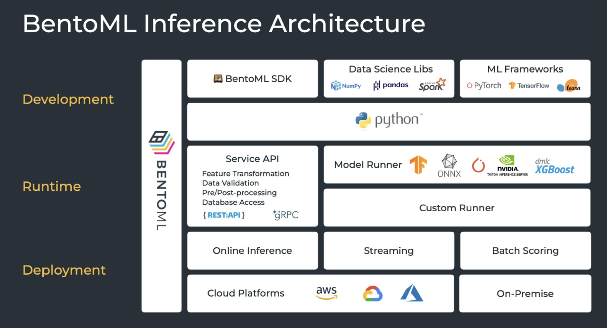
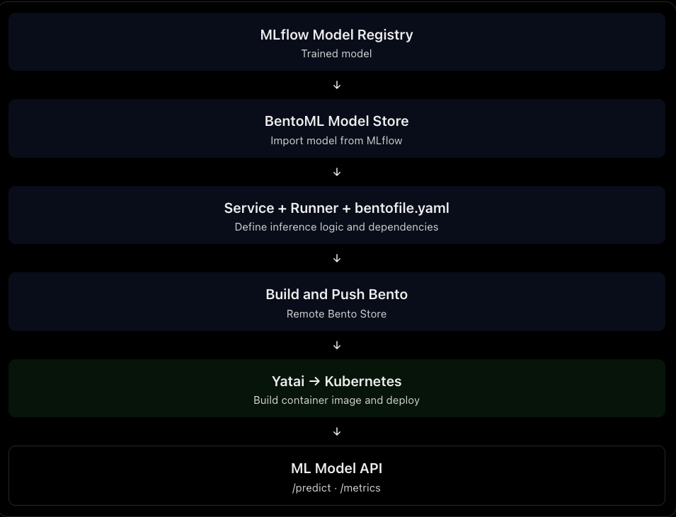
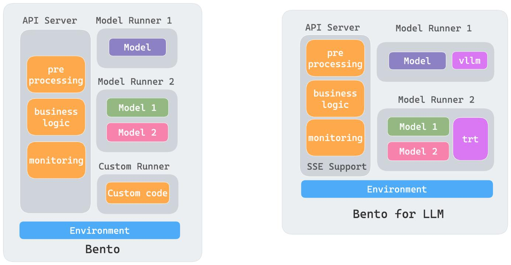
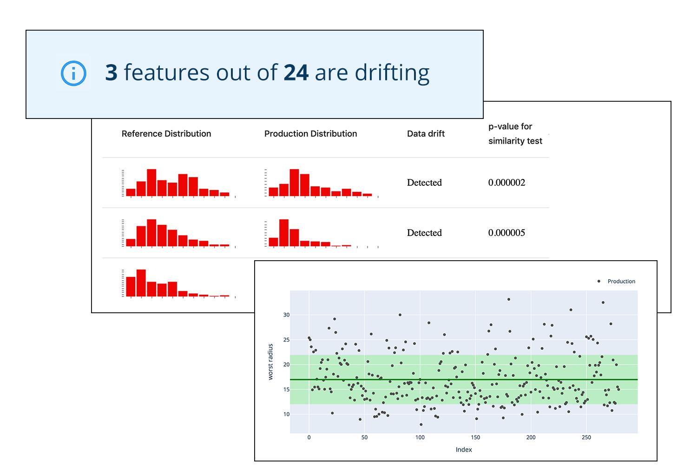
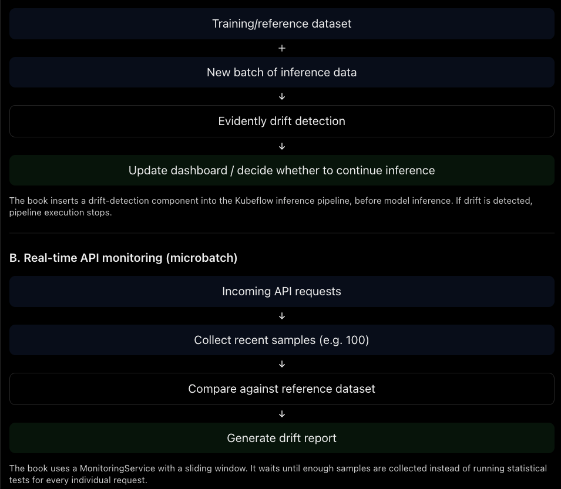
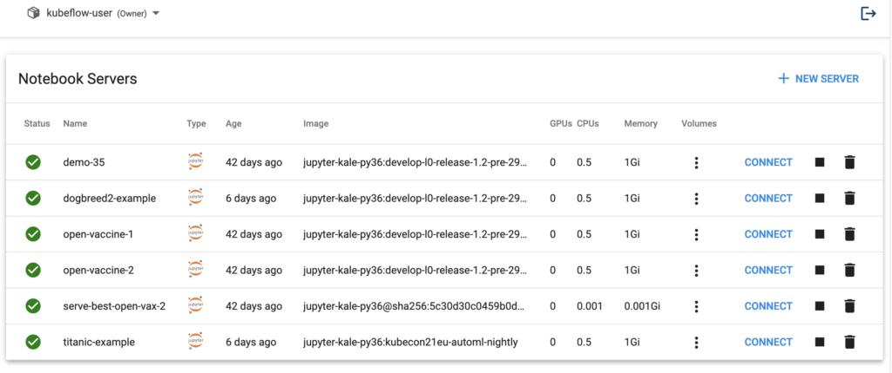
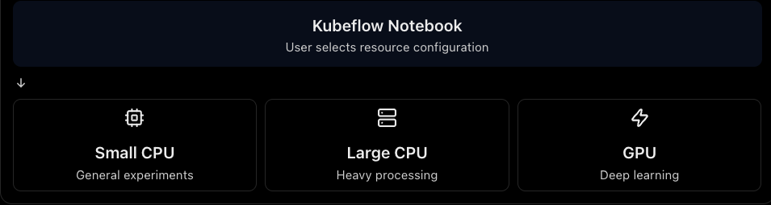
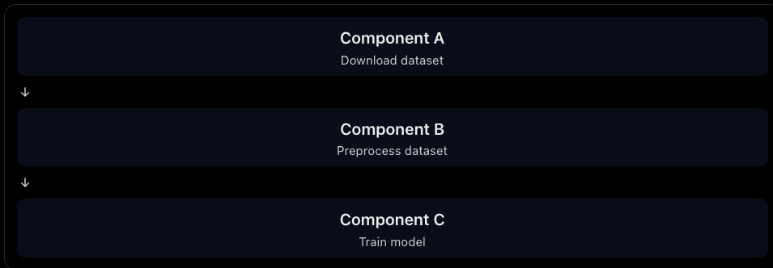
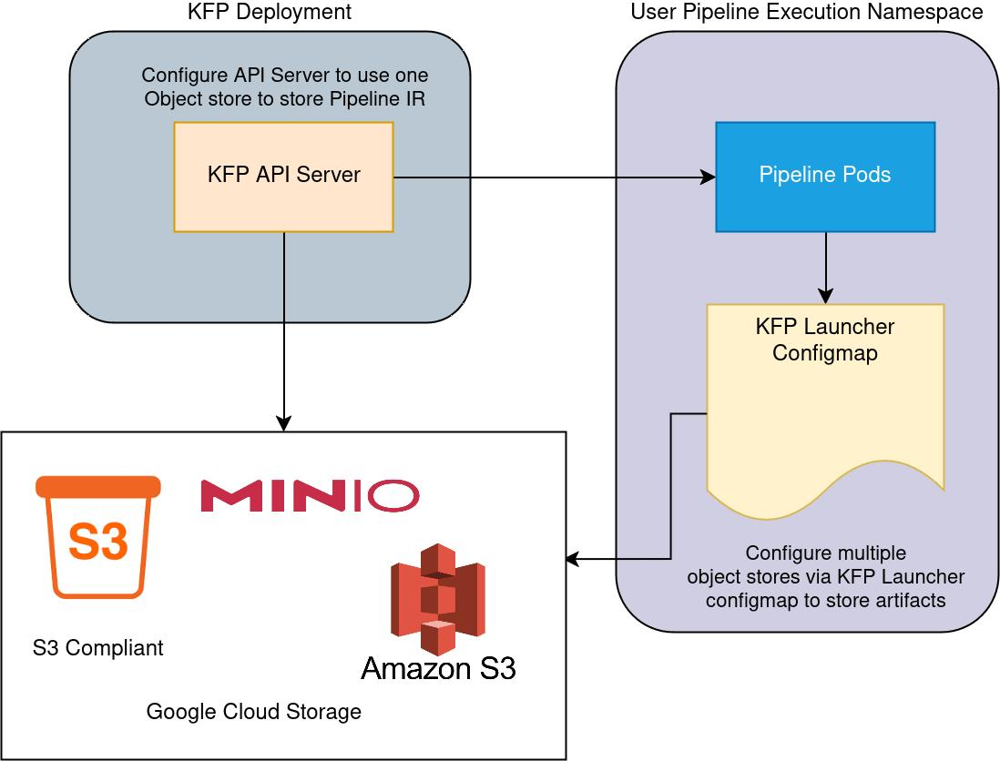
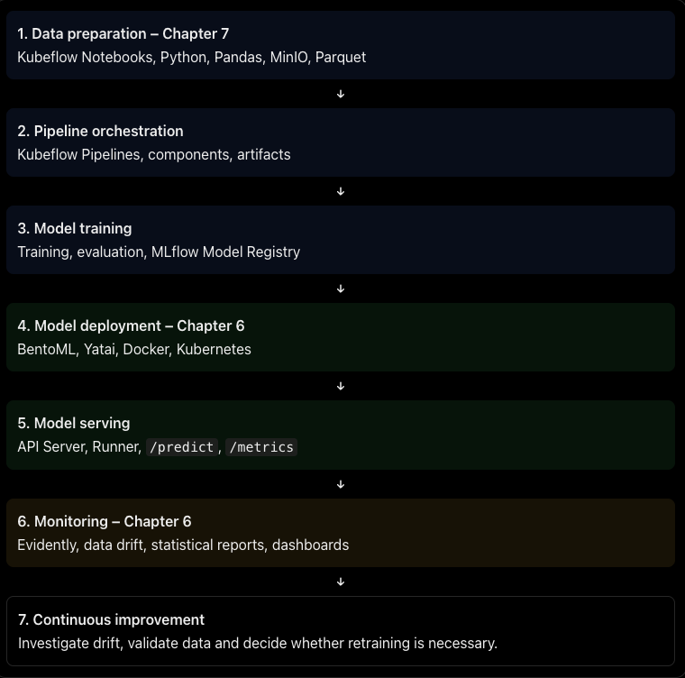

# Part 3 — Productionizing ML Models and Data Analysis and Preparation

> Source book: *Machine Learning Platform Engineering: Build an internal developer platform for ML and AI systems*  
> Scope: **Part 3 — The ML workflow**  
> Code: [https://github.com/practical-mlops](https://github.com/practical-mlops)  

---

## Overview

Chapter 6
Productionizing ML Models

How do we deploy a trained ML model and monitor it in production?
- Model serving with BentoML
- Kubernetes deployment through Yatai
- Data drift monitoring with Evidently

Chapter 7
Data Analysis and Preparation

How do we prepare data and build reusable ML pipeline components?
- Kubeflow Notebooks
- KFP v2 components and artifacts
- Dataset preparation and splitting
- Reusable, containerized pipeline components

The main idea: Chapter 7 prepares the data; Chapter 6 deploys and monitors the resulting model.

## Chapter 6 – Productionizing ML Models
### 1. BentoML: Deploying ML models as APIs



#### What problem does BentoML solve?
Traditionally, deploying an ML model requires several engineering tasks:
- Creating a Docker image.
- Writing Kubernetes manifests.
- Implementing an API endpoint.
- Configuring dependencies.
- Implementing monitoring.
- Setting up CI/CD.


BentoML simplifies this process by packaging the ML application into a standardized artifact called a Bento.

Think of Bento as a deployable package containing the application and its dependencies.
#### Important terminology

| Component | Responsibility |
| :--- | :--- |
| **Bento** | Packages the ML application |
| **BentoML** | Builds and manages ML application packages and serving |
| **Yatai** | Deploys, operates and scales Bento services on Kubernetes |
| **Runner** | Executes model inference independently |
| **Service** | Defines API serving logic |

#### Deployment workflow


#### Four steps to build a Bento

1. Register the model in BentoML.  
    - Import an existing MLflow model.  
    - Store it in the local BentoML model store.
2. Initialize the service and runner.
    - Runner performs model inference.
    - Service defines how the application handles requests.
3. Define bentofile.yaml.
    - Dependencies.
    - Python files.
    - Environment variables.
    - Service configuration.
4. Build and push the Bento.
    - Important commands from the chapter:
```
# Import/build
bentoml models list

# Build Bento
bentoml build -f bento/bentofile.yaml

# Push to remote store
bentoml push income_classifier_service

# Containerize locally
bentoml containerize income_classifier_service:TAG
```
#### Runner vs API Server – important for Kubernetes


The book demonstrates separate API Server and Runner pods.

| API Server | Runner |
| :--- | :--- |
| Receives incoming requests | Performs model inference |
| Exposes API endpoints | Holds model execution logic |
| Handles request-serving logic | Executes prediction |
| Can scale independently | Can scale independently |

For example, the book deploys:
- 1 API Server pod
- 2 Runner pods
DevOps takeaway: This is an important architectural distinction. API request handling and model inference have different resource and scaling requirements.

The deployed application also exposes:
- /predict – model prediction endpoint.
- /metrics – Prometheus-compatible metrics, including request rate and latency.
- Swagger documentation – API exploration and testing.

### 2. Evidently: Data drift monitoring



What is data drift?
A model is trained using historical data. However, real-world data changes over time.

When the statistical characteristics of incoming data differ from the training data, the model can start producing less reliable predictions.

Example:

Imagine a fraud detection model trained on historical transactions.
- Training data: 2% fraudulent transactions.
- Production data: 15% fraudulent transactions.
The distribution has changed. The model might no longer perform as expected.

#### Four types of drift

| Type | Meaning | Example |
| :--- | :--- | :--- |
| **Label drift** | Target/ground-truth definition changes | Definition of defective products changes |
| **Prior probability shift** | Class proportions change | Fraud cases increase |
| **Covariate shift** | Input feature distribution changes | Customer demographics change |
| **Sudden drift** | Unexpected distribution change | Pandemic changes customer behavior |

---

#### Statistical methods used by Evidently

| Method | Purpose | Important detail |
| :--- | :--- | :--- |
| **KS Test** | Compares distributions of numerical features | p-value below 0.05 can indicate drift |
| **Chi-square** | Tests categorical distribution changes | Useful for categorical features |
| **Wasserstein distance** | Measures distribution dissimilarity | Larger distance means greater difference |

The book explains that Evidently can select suitable statistical tests automatically, or you can explicitly configure them.
Reference data vs Current data
This is the most important concept to understand.
- Reference dataset: Historical/training data.
- Current dataset: New production/inference data.
Evidently compares the two datasets to detect changes.

The book uses:
```python
report = Report(metrics=[
    DataDriftPreset(),
])

report.run(
    reference_data=reference_data,
    current_data=current_data
)

report.save_html("drift_report.html")
```

The `DataDriftPreset` generates a report across dataset columns.

The chapter also introduces:  
- `DatasetDriftMetric()`  
- `DatasetMissingValuesMetric()`  
- `ColumnDriftMetric()`  
- `ColumnSummaryMetric()`  

#### Batch vs real-time drift monitoring
This is an important architectural distinction.



#### Why microbatching?

Running a statistical test against one individual API request is not meaningful for comparing distributions.

Instead:  
- Collect a defined number of requests.  
- Compare the sample against historical reference data.  
- Generate a report.  
- Remove older samples as new requests arrive.  
For a window size of 100, the service keeps the latest 100 samples.  

#### Chapter 6 key takeaway

Deploying a model is not the end of the ML lifecycle. You must monitor the incoming data and detect when the model's assumptions no longer hold.

## Chapter 7 – Data Analysis and Preparation

### 1. Kubeflow Notebooks



#### What problem does it solve?
ML engineers and data scientists need an environment where they can:  
- Explore and analyze datasets.  
- Experiment with models.  
- Access GPUs and specialized hardware.  
- Test preprocessing code.  
- Work in an environment similar to production.  
- Maintain reproducibility and version control.  
Kubeflow Notebooks provides familiar development environments inside the Kubernetes cluster.  

Supported interfaces discussed in the book:  
- Jupyter Notebook  
- VS Code (code-server)  
- RStudio  

#### Important Kubernetes concepts

| Concept | What it does |
| :--- | :--- |
| **Namespace** | Controls resources, quotas, volumes and secrets |
| **Workspace volume** | Persistent storage for notebook workspace |
| **Data volume** | Additional storage mounted into notebook |
| **PVC** | Requests persistent storage from Kubernetes |
| **PodDefault** | Injects environment variables, credentials or volumes |
| **Node affinity** | Attracts pods to selected nodes |
| **Tolerations** | Allows pods to run on nodes with matching taints |
| **ConfigMap** | Configures notebook UI options and available images |

#### Example: GPU notebook scheduling
Imagine your EKS cluster has:   
- Normal CPU nodes.  
- High-performance CPU nodes.  
- GPU nodes.  
You don't want every notebook consuming expensive GPU resources.  

Kubeflow allows administrators to configure affinity and tolerations so that users can select appropriate compute resources.  

#### Example scheduling architecture



#### Custom notebook images
The chapter also explains how to create custom notebook Docker images.

The image contains:  
1. Base dependencies.  
2. Notebook runtime (Jupyter or code-server).  
3. Runtime dependencies.  
4. Configuration files required by Kubeflow.  
The book recommends integrating these images into CI/CD to ensure reproducible development environments.  

DevOps takeaway: Kubeflow Notebooks is essentially a managed development environment running on Kubernetes, with resource scheduling, persistent storage, custom images and environment configuration.

### 2. Data passing in Kubeflow Pipelines (KFP)

This is probably the most important technical section of Chapter 7.

#### Why is data passing important?  
Each Kubeflow pipeline component executes in its own Kubernetes pod.

For example:


Because each component runs independently, we need a mechanism to transfer information between pods.

The book introduces two main scenarios.

#### Scenario A: Passing simple values
For small data such as:  
- Strings  
- Integers  
- Numbers  
- Boolean values  
KFP can pass outputs directly to downstream components.  

- Example:
```python
@dsl.component
def generate_joke() -> str:
    import pyjokes
    return pyjokes.get_joke()

@dsl.component
def count_words(input: str) -> int:
    return len(input.split())
```
- Pipeline connection:
```python
@dsl.pipeline(name="joke_pipeline")
def pipeline():

    joke = generate_joke()

    count = count_words(
        input=joke.output
    )
```

The important part:

joke.output automatically becomes the input to the next component.

KFP manages the serialization and data passing.
Scenario B: Passing large datasets
What happens when you're passing a dataset of several hundred GB?

You shouldn't return the entire dataset as a Python object.

Why?  
- High memory consumption.   
- Kubernetes pod memory limits.  
- Potential OOMKilled errors.  
- Unnecessary serialization overhead.  
Instead, the book recommends passing file or directory references.

Example:
```python
from kfp.dsl import Input, Output, Artifact

@dsl.component
def generate_data(
    output_data: Output[Artifact]
):
    with open(output_data.path, "w") as f:
        f.write("sample data")

@dsl.component
def process_data(
    input_data: Input[Artifact]
):
    with open(input_data.path, "r") as f:
        data = f.read()
```
The component doesn't pass the actual file contents directly through a Python return value.

Instead, KFP manages the artifact and its storage location.

#### How does data move between pods?


In the architecture described in the book:  
1. Component A writes output to its artifact path.  
2. KFP/Argo handles uploading the artifact to MinIO.  
3. Component B downloads the artifact.  
4. Component B accesses it through its local path.  
The book explains that the runtime commonly uses paths under /tmp and transfers artifacts through MinIO.  

#### Important distinction:
| Method | Suitable for |
| :--- | :--- |
| **Return values** | Small values such as strings and integers |
| **Input/Output artifacts** | Files and large datasets |
| **InputPath/OutputPath** | Older KFP v1-style file passing |
| **Input[T]/Output[T]** | KFP v2 typed artifact passing |

#### KFP v2 artifact types

KFP v2 provides specialized artifact types to make pipeline data more structured and maintainable.

| Artifact | Purpose |
| :--- | :--- |
| **Dataset** | Training, validation and test datasets |
| **Model** | Trained models, weights and checkpoints |
| **Metrics** | Accuracy, F1 score and numerical metrics |
| **ClassificationMetrics** | Confusion matrices and ROC curves |
| **SlicedClassificationMetrics** | Classification metrics for data subsets |
| **HTML** | Visual reports and dashboards |
| **Markdown** | Documentation, model cards and summaries |
| **Artifact** | Generic files and intermediate outputs |

Example:
```python
from kfp.dsl import Input, Output, Dataset, Model

@dsl.component
def train_model(
    dataset: Input[Dataset],
    model: Output[Model]
):
    trained_model = train(dataset.path)
    trained_model.save(model.path)
```

Why is this useful?  
- Type safety.  
- Standardized storage.  
- Metadata tracking.  
- Data lineage.  
- Model provenance.  
- Better integration with the Kubeflow UI.  
Remember: Use Dataset for data, Model for trained models, and Metrics for evaluation results.  

### 3. Building data preparation pipelines
This section demonstrates how to turn individual Python functions into reusable Kubeflow components.

The book uses two projects:  
1. ID card object detection.  
2. Movie recommendation system.  

In this section, I will skip the details of the projects and focus on the reusable pipeline components. In the following week, I will present again with a focus on the projects.

## Putting Chapters 6 and 7 Together
Now let's connect everything from an ML Engineering and DevOps perspective.

#### 1. End-to-end ML lifecycle
This is the architecture you should remember when working with MLOps.


#### 2. What should you remember as a DevOps Engineer?
These are the concepts I would prioritize:  

| Priority | Topic | Why it matters |
| :--- | :--- | :--- |
| **High** | **Kubernetes resource management** | Notebook and inference pod scheduling |
| **High** | **KFP components** | Independent execution and data passing |
| **High** | **Artifact management** | Data transfer between pods |
| **High** | **BentoML deployment** | Production model serving |
| **High** | **Data drift** | Production ML monitoring |
| **Medium** | **MinIO / S3** | ML dataset and artifact storage |
| **Medium** | **Parquet** | Efficient analytical data storage |
| **Medium** | **PodDefaults** | Runtime configuration |
| **Medium** | **Node affinity / tolerations** | GPU and compute scheduling |