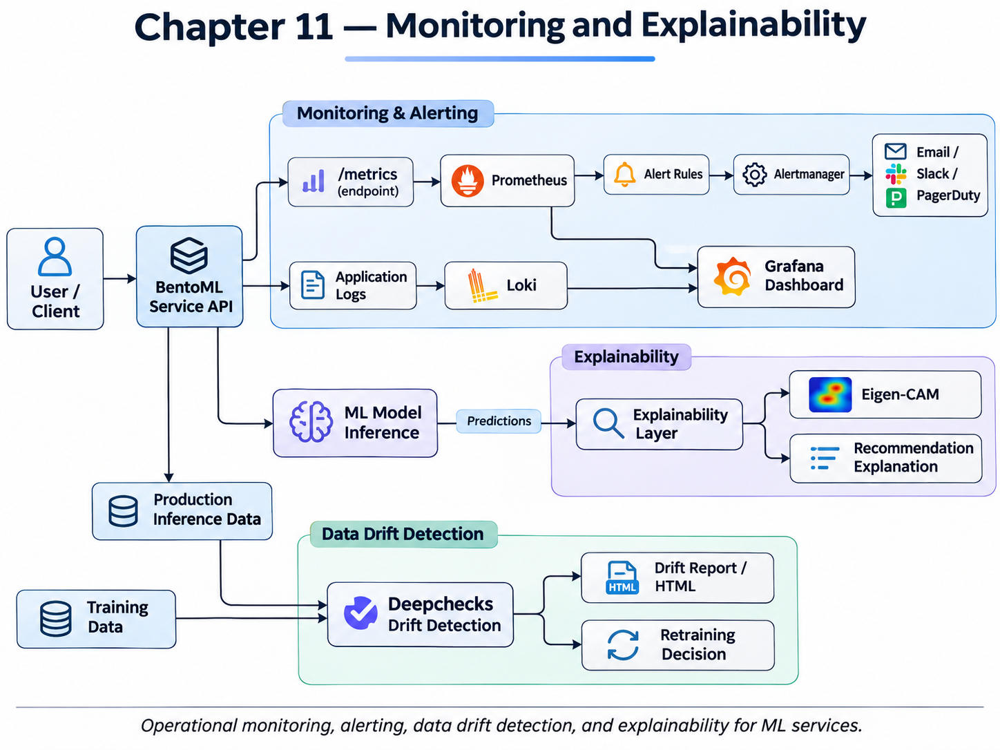
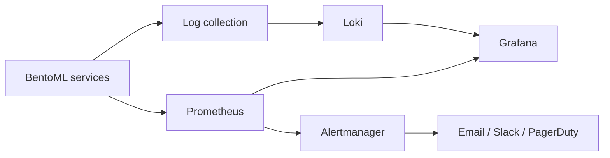

# Chapter 11. Monitoring and Explainability

> Source: Chapter 11, pp. 325–356. Practical setup steps are condensed.

## 1. Overview

Deploying a model is not the end of the ML lifecycle. Production systems require both operational monitoring and ML-specific monitoring. Explainability complements these by revealing which inputs contribute to predictions.



## 2. Monitoring (11.1)

### 2.1 Basic monitoring

| Category | Metrics |
|---|---|
| Resource utilization | CPU, memory, pod capacity |
| Request tracking | RPS, concurrent requests, latency, error rate |
| Service reliability | Availability, SLA compliance, error budget |
| Model-specific signals | Confidence distribution, prediction counts |

BentoML exposes `/metrics`. Prometheus discovers and scrapes application pods through a PodMonitor; Grafana visualizes the collected time series. The chapter uses Yatai deployments of an object detector and a movie recommender.



### 2.2 Custom metrics

A Counter tracks cumulative events; a Histogram records the distribution of observations. For object detection, record confidence scores. For recommendation, count requests with and without ranked movies.

```python
from prometheus_client import Histogram

confidence = Histogram(
    'confidence_score', 'Prediction confidence',
    buckets=[i / 10 for i in range(1, 11)]
)
# During inference:
confidence.observe(score)
```

```promql
histogram_quantile(0.9, sum(rate(confidence_score_bucket[5m])) by (le))
```

The query estimates P90 confidence. A low confidence distribution may indicate degraded image quality or model behavior, but confidence alone is not measured accuracy.

### 2.3 Logging

Metrics identify abnormal behavior; logs provide event-level evidence for debugging. BentoML uses Python logging. Loki aggregates logs and indexes labels rather than the entire log body, allowing correlation with Prometheus metrics through Grafana.

### 2.4 Alerting

Prometheus evaluates alert conditions; Alertmanager groups and routes notifications by labels and severity.

| Expression | Meaning |
|---|---|
| `up{job="yatai/bento-deployment"} == 0` | A discovered target cannot be scraped |
| `absent(up{job="yatai/bento-deployment"})` | No matching time series exists |

A `for: 5m` rule requires the condition to remain active before firing. Alert states progress from inactive to pending to firing. In production, scope missing-target checks appropriately and keep notification credentials outside committed Helm values.

## 3. Data drift detection (11.2)

Drift occurs when production data distributions differ from the reference distribution. Changes may indicate the need for investigation, feature updates, or retraining, rather than automatically proving performance degradation.

### 3.1 Object detection

The chapter uses Deepchecks `ImagePropertyDrift` to compare reference images with images whose brightness has been modified. Features include brightness, contrast, aspect ratio, image area, and color intensity. The Kolmogorov–Smirnov statistic compares distributions.

| Image property | Example drift score |
|---|---:|
| Brightness | 0.619 |
| RMS contrast | 0.310 |
| Aspect ratio | 0 |
| Area | 0 |

Figures 11.16–11.18 demonstrate that changing brightness shifts its distribution while leaving geometry unchanged.

### 3.2 Movie recommendation

Matrix factorization represents users and items using latent factors. Changes in movie ratings can shift learned factors; Deepchecks `FeatureDrift` compares their distributions across datasets. Figure 11.19 illustrates a shifted item-factor distribution.

Workflow: collect inference data → build reference/current windows → compute drift scores → investigate → decide whether to update data or models. For independently trained embeddings, comparable coordinate systems must be established before interpreting per-dimension drift (implementation consideration).

## 4. Explainability (11.3)

Explainability supports debugging, stakeholder trust, bias investigation, and accountability.

| Approach | Description | Examples |
|---|---|---|
| Model-based | Interpretability provided by model structure | Linear models, decision trees, explainable matrix factorization |
| Post hoc | Analyze a trained model to explain outputs | SHAP, LIME, Eigen-CAM |

- **Object detection:** Eigen-CAM generates a heatmap showing spatial regions emphasized by convolutional activations. It helps investigate detections and missed objects, but is not proof of causal reasoning.
- **Recommendation:** Explainable Matrix Factorization (EMF) adds recommendation explanations based on ratings from similar users. Some recommendations may lack a usable explanation.

## 5. Production takeaways

- Monitor service reliability and model behavior independently.
- Correlate metrics, logs, model version, and inference events.
- Treat drift as an investigation signal; validate performance before retraining.
- Protect sensitive inference data and avoid indiscriminate payload logging (operational recommendation).

## 6. Review questions

1. How does `up == 0` differ from `absent(up)`?
2. When should a Histogram be used rather than a Counter?
3. How does image drift differ from tabular drift?
4. What is the difference between post hoc and model-based explainability?
5. Why does a healthy API not guarantee a healthy ML model?
