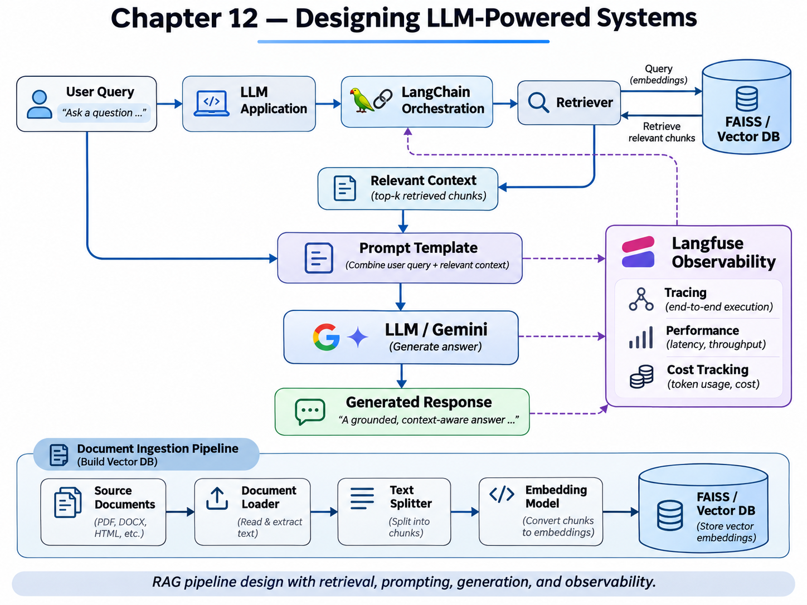
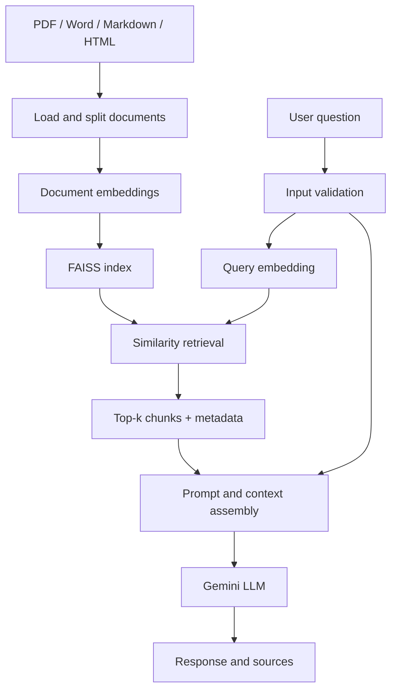
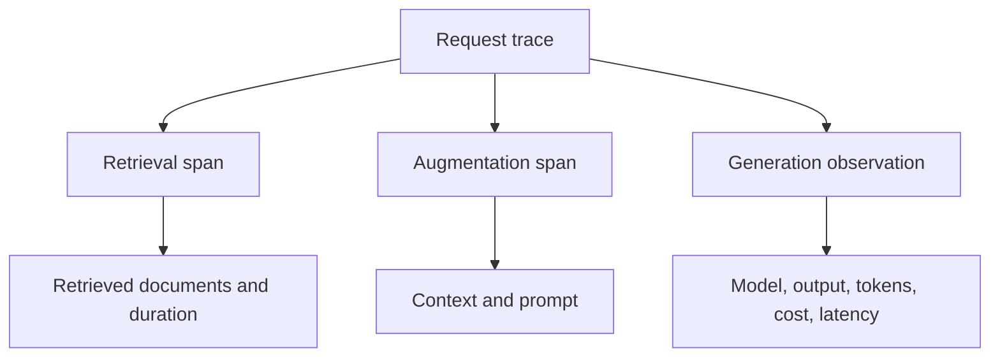

# Chapter 12. Designing LLM-Powered Systems

> Source: Chapter 12, pp. 359–408. The DakkaBot implementation is summarized rather than reproduced.

## 1. Overview

LLMOps extends existing MLOps infrastructure with retrieval, embeddings, prompt management, semantic evaluation, and token-aware observability. The chapter builds DataKrypt's internal documentation chatbot, DakkaBot.



## 2. LLMOps: New challenges, familiar principles (12.1)

| Traditional ML | LLM applications |
|---|---|
| Model artifact and feature pipeline | Model, prompts, embedding model, index, retrieval settings |
| Often fixed-size predictions | Variable-length, probabilistic generation |
| Accuracy and latency | Semantic quality, grounding, safety, token usage, streaming latency |
| Compute-oriented capacity | Compute, token throughput, context limits and provider quotas |

Temperature zero can reduce variation but does not guarantee identical outputs. Testing must accommodate multiple valid responses. Kubernetes, containerization, ingress, HPA, CI/CD and monitoring remain useful. Figure 12.2 shows traditional ML and LLM workloads sharing a Kubernetes infrastructure layer.

### Essential components

| Tool | Responsibility |
|---|---|
| Gemini | Text generation and embeddings in the example |
| LangChain | Composable retrieval and generation pipelines |
| LangGraph | Graph-based workflows with branching, loops and state |
| FAISS | Similarity search over indexed vectors |
| Chainlit | Conversational UI and streamed responses |
| Langfuse | Traces, token consumption, cost and prompt observability |

## 3. Building DakkaBot: RAG architecture (12.2)

Retrieval-Augmented Generation separates external knowledge retrieval from model generation. Documentation can be updated and reindexed without retraining the generation model.



Figure 12.5 separates build-time document ingestion from query-time retrieval and generation.

### 3.1 Composability

Separate embedding, retrieval, augmentation, and generation into reusable components. LangChain's runnable composition enables these components to be combined without tightly coupling them to one provider. Use graph-based orchestration when conditional or iterative workflows exceed a simple chain's requirements.

### 3.2 Gemini and embeddings

An embedding maps text into a numerical vector representing semantic meaning. The chapter wraps Google's embedding API in a LangChain-compatible class and uses distinct task types for indexing documents (`RETRIEVAL_DOCUMENT`) and searching queries (`RETRIEVAL_QUERY`). Index and query vectors must use compatible embedding models.

### 3.3 Retrieval

- Load company documents and preserve their source metadata.
- Split documents into chunks that fit the context budget.
- Embed chunks and construct a FAISS index.
- Embed an incoming question and select the top-k relevant chunks.

Chunk size, overlap and retrieval depth influence relevance and cost. FAISS is a vector similarity-search library; the application is responsible for persistence and operational management.

### 3.4 Augmentation and generation

Format retrieved chunks into a context, combine that context with the question and system instructions, and invoke the LLM. The prompt should constrain responses to the available documentation and encourage appropriate handling of missing evidence.

Conceptual LangChain composition (illustrative, not a complete runnable implementation):

```python
chain = (
    {'context': retriever | format_docs, 'question': RunnablePassthrough()}
    | prompt
    | llm
    | StrOutputParser()
)
```

Token budget includes instructions, question, retrieved context and generated output. Excessive retrieval can exhaust the context window or raise costs. Validate input before expensive model calls.

## 4. Chat interface (12.3)

The chapter separates reusable `DakkaBotCore` logic from the Chainlit UI. The core manages retrieval, generation and structured results; Chainlit manages chat sessions, events, progress and streamed responses. This separation keeps the interface replaceable and supports testing the core independently.

## 5. Observability for LLM applications (12.4)

Langfuse is introduced through a Docker-based setup and integrated with the chatbot. Each request can be traced through retrieval, augmentation and generation.



| Dimension | What to inspect |
|---|---|
| Retrieval | Relevant documents and intermediate results |
| Generation | Prompt, model configuration, output and errors |
| Cost | Input/output tokens and estimated spend |
| Responsiveness | Time to first token and total duration |
| Quality | Relevance, correctness, hallucinations and user satisfaction |

Figure 12.9 shows a Langfuse trace with intermediate results, inputs, outputs and costs. Infrastructure metrics remain necessary, but cannot explain failures in semantic retrieval or context assembly.

## 6. Production takeaways

- Version the prompt, embedding model, retrieval configuration and generation model separately.
- Keep ingestion and query serving logically separated.
- Monitor end-to-end traces alongside Kubernetes metrics.
- Apply access control and sensitive-data redaction to traces (operational recommendation).

## 7. Review questions

1. How does RAG update knowledge without model retraining?
2. What is the role of embeddings and FAISS?
3. How do retrieval and augmentation differ?
4. When would LangGraph be preferable to a sequential LangChain pipeline?
5. Why are Prometheus metrics insufficient for diagnosing poor RAG answers?
