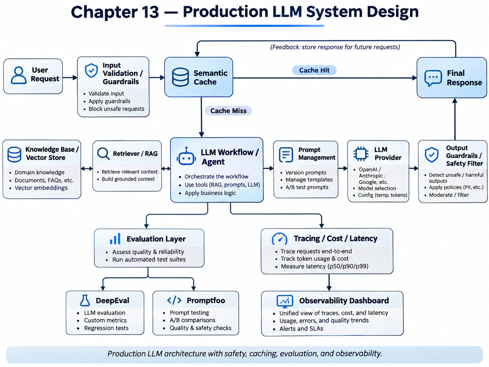
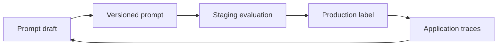
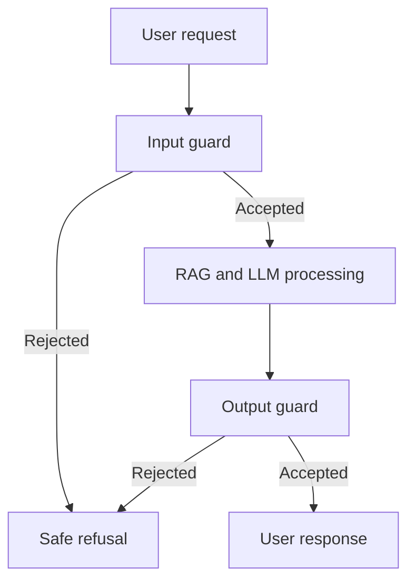

# Chapter 13. Production LLM System Design

> Source: Chapter 13, pp. 409–453. Detailed setup and repeated test listings are condensed.

## 1. Overview

A working LLM prototype becomes a production system through managed prompts, semantic evaluation, adversarial testing, safety controls, and cost optimization. The chapter extends DakkaBot with these operational practices.



## 2. Prompt engineering (13.1)

Prompts influence application behavior like software configuration. Treat them as versioned artifacts instead of hardcoded strings.

- Define roles, boundaries, context, expected response behavior and examples.
- Manage versions and environment labels in Langfuse.
- Evaluate prompt changes before promoting them to production.
- Use cached or fallback prompts when remote prompt retrieval fails.



Langfuse enables prompt changes independently of application releases, audit history, collaborative editing and comparison of prompt variants. Rollback can be implemented by reassigning the production label to a previously approved version.

## 3. Testing LLM applications (13.2)

Exact string matching is insufficient when multiple differently worded answers are valid. Deterministic components still benefit from ordinary unit tests; generated responses require semantic evaluation.

### 3.1 DeepEval and G-Eval

DeepEval evaluates LLM responses using configurable metrics. G-Eval uses a judge LLM and domain-specific criteria. The chapter configures Gemini as the judge and wraps the asynchronous DakkaBotCore interface to support synchronous tests.

| Evaluation dimension | Example criterion |
|---|---|
| Relevance | Does the answer address the question? |
| Factual quality | Is the answer supported by available evidence? |
| Helpfulness | Is the response actionable for an employee? |
| Security | Does it avoid exposing credentials and restricted data? |
| Scope | Does it remain within its enterprise documentation role? |

Define a test input, collect the actual response, provide evaluation criteria and compare its score with a threshold. Judge outputs are themselves imperfect; thresholds and criteria should be validated against representative cases (implementation consideration).

### 3.2 Safety and adversarial testing

Promptfoo automates evaluation across test cases and adversarial scenarios. The chapter covers prompt injection, jailbreak attempts and scope violations. Test the application before release and use repeated evaluation to detect regressions when prompts or models change.

## 4. Governance and safety (13.3)

Guardrails AI provides a framework for validating inputs and outputs using reusable or custom validators. Figure 13.6 illustrates multilayer protection rather than allowing requests and responses to pass directly through the LLM.



| Layer | Controls |
|---|---|
| Input | PII detection, malicious instruction detection, topic/scope validation |
| Processing | Enforce application boundaries during retrieval and generation |
| Output | Sensitive data, harmful language, policy violations and grounding checks |
| Monitoring | Record failures and review safety trends |

Guardrails reduce risk but do not guarantee security. Authorization and access control must be enforced independently of prompts (operational recommendation).

## 5. Cost optimization (13.4)

### 5.1 LLM economics

Hosted APIs commonly charge for input and output tokens. Long retrieved contexts and generated answers increase cost. Managed endpoints and self-hosted models have different cost structures; open-weight models do not eliminate infrastructure or operational expenses.

```text
Model request cost = input tokens × input token price
                   + output tokens × output token price
```

Use consistent price units, and account separately for embedding, evaluation, infrastructure and other service costs. The chapter's price illustrations are historical examples, not current quotes.

### 5.2 Model selection

Route simpler requests to smaller or cheaper models and reserve more capable models for complex tasks. Evaluate quality, latency and cost together before routing production traffic.

### 5.3 Caching

| Cache type | Reuses | Trade-off |
|---|---|---|
| Context caching | Repeated prompt/document context | Requires freshness and provider-aware cost analysis |
| Semantic caching | Answers to semantically similar questions | False matches and stale responses |

Semantic caching uses embeddings and a similarity threshold. A threshold that is too permissive may return irrelevant responses; an overly strict one loses cache hits. Invalidate cached data when source documents or relevant prompt versions change. Partition caches by authorization scope where required (operational recommendation).

### 5.4 Prompt optimization

Reduce redundant instructions and unnecessary context, tune retrieval depth and chunk sizes, and constrain answer length while measuring response quality. Token reductions should not undermine grounding or safety.

### 5.5 Production cost monitoring

Track token consumption, cost by request/model, cache performance and quality metrics. Use Langfuse traces to attribute spending to pipeline stages. Define alerts for abnormal usage and degradation.

### 5.6 Infrastructure evolution

Existing Kubernetes infrastructure remains relevant. Variable token workloads require capacity planning beyond CPU utilization alone: observe request concurrency, token load, queueing, memory and provider limits as appropriate. Keep quality and safety evaluation connected to release workflows.

## 6. Production release checklist

- [ ] Version and evaluate prompts before promotion.
- [ ] Run semantic quality tests and adversarial tests.
- [ ] Enable input and output validation.
- [ ] Monitor latency, errors, tokens, cost and response quality.
- [ ] Validate cache freshness and model-routing quality.
- [ ] Establish rollback and incident-response procedures.

## 7. Review questions

1. Why should prompts be treated as code?
2. How does G-Eval differ from exact-match testing?
3. What is Promptfoo's role in safety testing?
4. How do input and output guardrails complement each other?
5. What is the difference between context and semantic caching?
6. How would model routing reduce cost without sacrificing quality?
