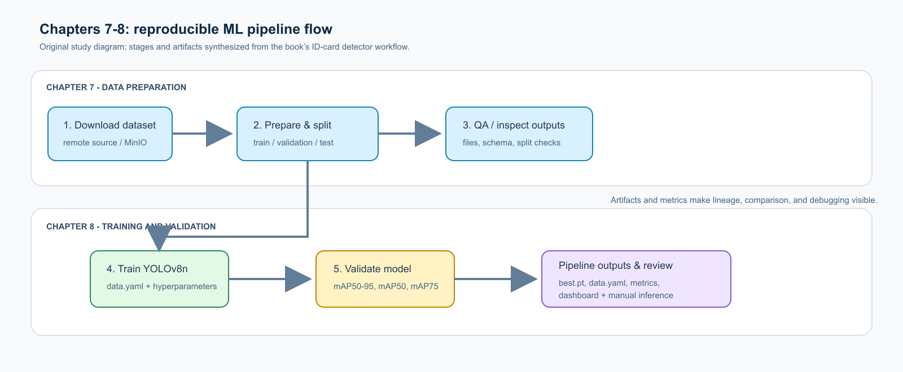

# Part 3 — Productionizing ML Models and Data Analysis and Preparation

> Source book: *Machine Learning Platform Engineering: Build an internal developer platform for ML and AI systems*  
> Scope: **Part 3 — The ML workflow practice**  
> Code: [https://github.com/practical-mlops](https://github.com/practical-mlops)  

---

## Overview

**Scope:** Chapter 7, *Data analysis and preparation*, and Chapter 8, *Model training and validation: Part 1*.

**Source boundary:** This guide summarizes only the supplied chapters. “Observed” means the book shows or states a result from its example. “Expected / recommended” means a design goal, suggestion, or general claim - not a measured result from a new experiment.

## Part 3 in one view

Part 3 turns earlier platform ideas into two practical ML projects: an ID-card detector and a MovieLens recommender. Chapter 7 creates reproducible data-preparation pipelines; Chapter 8 extends the ID-card pipeline with training, validation, metrics, and hands-on artifact checks.

The central lesson is that a model is only one output of a system. Data locations, splits, images, dependencies, parameters, metrics, and saved weights must all be managed as reproducible pipeline artifacts.

## Chapter 7 - Data analysis and preparation

### What you will learn

- Use Kubeflow Notebooks for interactive work close to datasets and compute resources.
- Configure notebook images, resources, workspace/data volumes, PodDefaults, affinity, and tolerations.
- Build repeatable Kubeflow Pipelines (KFP) from reusable components.
- Pass small values as parameters and large data as typed artifacts/paths.
- Prepare datasets for object detection and recommendation: download, transform, split, upload, and check them.

### Core concepts

| Concept | Meaning in the chapter |
| --- | --- |
| Kubeflow Notebook | Browser-based Jupyter, VS Code, or RStudio environment running on the same cluster as pipelines. This helps development resemble deployment. |
| Workspace volume vs. data volume | A workspace is persistent notebook storage (normally mounted at `/home/jovyan`); a data volume is typically an existing PVC mounted at runtime. |
| PodDefault | Namespace configuration injected into a pod, such as proxy settings, tracking URI, credentials, or volume mounts. |
| Affinity / toleration | Scheduling controls used to target or restrict special nodes, such as GPU nodes. |
| Custom notebook image | A layered image: base dependencies -> Kubeflow-compatible Jupyter/code-server runtime -> project-specific dependencies. |
| KFP component | An isolated pipeline step. Its imports belong inside its function; its runtime dependencies are declared with the component. |
| Parameter vs. artifact | Use direct parameters for small values. Use `Input[T]`/`Output[T]` artifacts and `.path` for files/directories and large data. |
| Typed artifact | KFP v2 types such as `Dataset`, `Model`, `Metrics`, `ClassificationMetrics`, `HTML`, `Markdown`, and generic `Artifact`. Types add meaning, metadata, lineage, and UI support. |
| Reproducibility | Fixed `random_state`, versioned images/code/data, declared dependencies, and pipeline YAML make a run easier to repeat and inspect. |

### Data-passing rules to remember

- Components run in separate Kubernetes pods; do not assume local files are shared.
- Passing a huge raw value risks memory exhaustion (`OOMKilled`). Write data to an output artifact and pass the artifact to the next component.
- In KFP v2, replace v1 `InputPath`/`OutputPath` conventions with typed `Input[T]`/`Output[T]`, access files through `.path`, and record useful metadata.
- The output-to-input connection defines a dependency: KFP schedules the upstream component first.
- Generated pipeline YAML contains both component definitions and plumbing for arguments, serialization, and artifact handling.

### Worked pipeline 1: ID-card object-detection data

**Goal:** turn the filtered MIDV-500 ID-card data into YOLO-ready training, validation, and test datasets.

**Dataset and format:** MIDV-500 contains 500 video clips covering 50 document types; the example filters it to ID cards. YOLO expects a root path with `train`, `val`, and `test` image folders and corresponding adjacent `labels` folders. The only class is `id_card` (class `0`).

**Process:**

1. Download the compressed dataset from a remote location.
2. Extract it.
3. Store prepared files in an S3-compatible MinIO bucket.
4. Use a `Dataset` artifact as the component output/input rather than copying a large raw dataset between pods.
5. Use scikit-learn `train_test_split` twice, with a fixed random state, to make a 75% train / 15% validation / 10% test split.
6. Create `images` and `labels` directories in each split and copy matched files.
7. Run a throwaway inspection component that prints the output directory tree as a sanity check.
8. Compile to YAML, upload to KFP, choose/create an experiment, create a run, and inspect the graph and component logs.

**Observed result in the book:** the fully executed KFP is shown, including download, split, and two output-file-contents steps. The authors say the complete process took about 30 minutes on their machine.

**Expected / recommended, not a measured result:** logging gives early visibility into trouble; production needs log rotation/archival because verbose recurring runs can consume storage and cause Kubernetes disk-pressure issues.

### Worked pipeline 2: MovieLens recommender data

**Goal:** make MovieLens 25M data ready for training while demonstrating file shuttling, containerized Python components, MinIO storage, and QA.

**Dataset:** MovieLens 25M has 25 million ratings and 1 million tag applications for 62,000 movies from 162,000 users. The book asks readers to follow its license terms.

**Six-component process:**

1. Download the MovieLens zip.
2. Extract `ratings.csv` and `movies.csv`.
3. Convert CSV to gzip-compressed Parquet for column-oriented storage.
4. Split ratings into 75% train / 15% validation / 10% test and write three Parquet files.
5. Upload the split folder and movies file to MinIO.
6. Use PyArrow to read from MinIO and run simple QA: expected columns, expected files, and a training-set size of roughly 75% of 25 million.

**Why Parquet and containerized components:** Parquet is a better fit for tabular/columnar access than plain CSV. A `target_image` creates a containerized Python component whose dependencies are installed at build time, rather than each run; Kubeflow recommends this when `packages_to_install` is used. It needs a Docker daemon, Docker API socket, Unix environment, and image-registry access.

**Observed result in the book:** the successful pipeline graph is shown with the two CSV-to-Parquet conversions, split, uploads, and QA. The text describes the QA as deliberately rudimentary; it checks four expected files and an approximate 75% training-size condition.

**Expected / recommended, not a measured result:** validate assumptions early and comprehensively - size, schema, and content - rather than relying on downstream failures or retrospective debugging.

### Chapter 7 examination / experiment view

There is no formal exam in these chapters. Treat the two pipelines as practical examinations.

| Practical check | What success looks like |
| --- | --- |
| Notebook setup | Notebook launches in the correct namespace with deliberate image, resource, storage, and scheduling choices. |
| Artifact passing | A downstream component reads an upstream artifact through its typed input and `.path`, without manually copying raw large payloads. |
| ID-card preparation | Three reproducible YOLO-compatible splits exist, each with aligned `images` and `labels` folders. |
| MovieLens QA | Expected Parquet outputs can be read from MinIO; schema and approximate training-split size assertions pass. |
| Pipeline operation | Compiled YAML uploads, a run executes, and the UI graph/logs expose dependencies and progress. |

### Chapter 7 takeaways

- Good data preparation is foundational: poor-quality or poorly managed input undermines any model.
- Keep interactive exploration and automated pipelines close to the data and aligned with the deployment environment.
- Prefer typed artifacts, metadata, and remote/object storage patterns for scalable pipeline data flow.
- Pipeline components should be composable, isolated, and explicit about their dependencies.
- The next chapter consumes these prepared splits to train and validate an ID-card detector.

## Chapter 8 - Model training and validation: Part 1

### What you will learn

- Design modular, reproducible training components for a production pipeline.
- Configure and fine-tune YOLOv8 for a custom ID-card class.
- Choose model size and hyperparameters with performance, compute, memory, and training-time trade-offs in mind.
- Build a container component when system packages are required.
- Log validation metrics as KFP artifacts and inspect model weights manually.

### Training design and key concepts

| Concept | Meaning in the chapter |
| --- | --- |
| YOLO data YAML | Declares dataset root/splits and class names; YOLOv8 infers labels from sibling `labels` directories. |
| YOLOv8n | Nano YOLOv8. The book starts with it to conserve compute, test feasibility quickly, and iterate before moving larger. |
| `epochs` | Complete passes through training data. More can help but cost time; too few can leave `best.pt` undertrained. |
| `batch` | Images per iteration. Larger batches can process faster but consume more GPU memory and can change learning behavior. |
| `imgsz` | Input image dimension (640 in the example). Larger images may help accuracy but increase memory/time. |
| `project` / `name` | Identify where YOLO saves weights, curves, matrices, and sample inferences. |
| `best.pt` | Weights saved from the best validation performance during the run; it may come from an earlier epoch, not necessarily the final one. |
| Container component | `@dsl.container_component` with `dsl.ContainerSpec` can run system commands such as `apt-get`, unlike a standard Python component. |
| Validation metric | KFP logs `map50-95`, `map50`, and `map75` from YOLO validation as a `Metrics` artifact. |

### ID-card training and validation pipeline

**Goal:** train a YOLO model to detect the `id_card` class, validate it against the validation split, keep outputs inspectable, and make the workflow repeatable.

**Process:**

1. Reuse Chapter 7’s download and split components.
2. Build `data.yaml` with train/validation/test image paths and the single `id_card` class.
3. Start from pretrained `yolov8n.pt`; call `model.train()` with image size 640, pipeline-supplied `epochs`/`batch`, project directory, and model name.
4. Copy YOLO’s selected `best.pt` into the KFP `Model` output artifact; output `data.yaml` as a generic artifact.
5. Use a container component when needed to install system libraries (`libgl1-mesa-glx`, `libglib2.0-0`) plus required Python packages. The book injects a training script with a heredoc and maps KFP artifact paths/parameters to CLI arguments.
6. Build a lighter validation component from an Ultralytics base image; load `best.pt`, call `model.val()`, and log mAP metrics.
7. Compile/upload/run the training-and-validation pipeline; inspect run outputs, raw artifacts, and cross-run metric views in the KFP UI.

### Results: observed versus expected

| Item | What the book actually demonstrates | What should not be overstated |
| --- | --- | --- |
| Pipeline execution | A successful graph with download, split, train, and validate steps; KFP shows the metric artifact in Run Output, raw artifacts, and overview comparisons. | No single numeric mAP result is reported in the supplied pages. |
| Training duration | On the authors’ Kubernetes cluster, one epoch on the provided data takes about one hour. | This is environment-specific, not a general timing guarantee. |
| Default pretrained model | On the shown driver-license image, the generic Nano model detects faces as persons and labels the ID card as a book with 0.28 confidence; a larger person detection has 0.79 confidence. | The example is not a benchmark of generic YOLO accuracy. |
| One epoch of custom training | The displayed example correctly classifies the ID card and mostly surrounds it, but the box is imperfect. | It is promising evidence, not proof of production readiness. |
| About five epochs | The displayed example has a box covering the whole card and “decent” confidence. | “Five epochs improves every project” is not established; the required count depends on data and requirements. |

### How to examine a trained artifact

**Automated check:** use the validation component to calculate mAP50-95, mAP50, and mAP75 on the validation data and view them in KFP. Keep metric history visible for comparison.

**Manual sanity check:** download the training project artifact, unpack it, find `best.pt`, run inference on sample images not used for training, and inspect the predicted label, bounding box, and confidence score (0 to 1).

**Production-minded extension recommended by the book:** automate toleranced checks for confidence and reasonable box coordinates. Exact values are problem-specific; choose thresholds and tolerances for the application rather than assuming an absolute rule.

### Chapter 8 examination / experiment view

| Exercise | Goal | Evidence of completion |
| --- | --- | --- |
| Train with pipeline defaults | Establish a reproducible baseline. | Pipeline parameters, model/data artifacts, logs, and metrics appear in KFP. |
| Compare untrained vs. trained weights | Verify that domain training changes behavior. | Generic model mislabels the card; the book’s trained examples identify it as an ID card. |
| Increase epochs carefully | Explore the accuracy/time trade-off. | Compare recorded validation metrics and manual inference; use `best.pt`, not automatically the final epoch. |
| Tune only when evidence calls for it | Address lack of convergence or unmet requirements. | Alter learning rate, batch size, or epochs based on previous jobs, then retain the comparison trail. |

### Chapter 8 takeaways and what comes next

- Production training needs versionable data access, explicit artifact flow, durable outputs, and visible metrics - not just a `train()` call.
- Select architecture against the real latency, memory, accuracy, and budget constraints of the application.
- Validation metrics and manual inspection complement each other: the former makes comparisons systematic; the latter catches surprising behavior.
- Start with a small hyperparameter set and expand it as the evidence and use case demand.
- Chapter 9 scales this work with Kubernetes PersistentVolumes for efficient shared data access, plus MLflow and TensorBoard for experiment tracking, lineage, and visualization. It also applies these ideas to the movie recommender.

## Rapid review questions

1. Why is passing a path/artifact safer than passing a huge raw dataset between KFP components?
2. Which KFP artifact type would you use for a trained weight file, a data split, and scalar validation scores?
3. How do a notebook workspace volume and a data PVC differ?
4. Why is a fixed `random_state` useful when splitting data?
5. What makes `best.pt` different from “the weights from the last epoch”?
6. Which Chapter 8 claims are observed examples, and which are only expected improvements?
